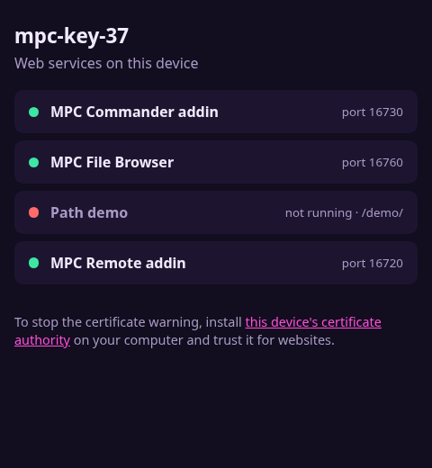

# MPC Gateway

> [!WARNING]
> **This is not a Caddy project.** I'm not affiliated with the Caddy developers, and they have nothing to do with this
> addin. It was built with AI ([Claude Code](https://claude.ai/code)). If something goes wrong while you're using it,
> please **don't report it to Caddy**. Open an issue [here](https://github.com/jacob-sabella/mpc-addin-gateway/issues)
> instead.

One front door, with one password, for the web pages addins run on your MPC.

Addins such as MPC Remote, MPC Commander and MPC File Browser each run a small web server on the device. For safety
they only listen on the device itself, so until now you needed one SSH tunnel per addin to use them. MPC Gateway runs
[Caddy](https://caddyserver.com) beside MPC as a single HTTPS address for all of them. Log in once and you get a start
page listing every addin that has a web page, each marked running or not, one click away. The addins themselves keep
listening on the device only; only the gateway faces the network, and nothing gets past it without the password.



It works on MPC OS standalone devices (MPC Live, One, X, Key and Force, and the MPC Sample), Gen1 and Gen2.

## Connecting

The password is made at the first start, and you can read it over SSH:

```sh
cat /data/mpc-addins/gateway/password.txt
```

The user name is always **mpc**. To pick your own password instead, set `password=` in the settings (below).

By default the gateway, too, listens on the device only. Reach it through one SSH tunnel for everything:

```sh
ssh -N -L 8443:127.0.0.1:443 root@<device address>
```

then open `https://localhost:8443`. To skip the tunnel, set `bind=0.0.0.0` in the settings (a first install asks you)
and open `https://<device address>` from any computer or phone on the same network.

### The certificate warning

The gateway uses HTTPS, so the password never crosses your network in the clear. Its certificates come from a small
certificate authority the device makes for itself (nothing is fetched from the internet), so a browser warns the first
time. You can click past it, or get rid of it for good: download the certificate authority from the link at the bottom
of the start page and install it on your computer as trusted for websites.

## The start page

Every addin that declares a web page in its `addin.manifest` is listed, with a green dot while its server is running and
a red one when it isn't (for example, an addin you switched off with `enabled=0`). Install or remove an addin and the
list follows within seconds. An addin that works under a path of the gateway opens there (`https://<device>/files/`);
any other opens on a port of its own, its port plus 10000 (MPC Remote on 6720 becomes `https://<device>:16720`).
Every one of them asks for the same password. A page whose addin isn't running answers with a short message saying
so, with a link back to the start page.

The gateway only lists what addins declare. It never guesses by looking at which programs listen where or by sending
requests to ports: MPC's own internal ports look just like an addin's from outside, and a stray request could disturb
MPC while you play.

## For addin authors: declaring a web page

Add these lines to your addin's `addin.manifest` (the keys are in mpc-vst-plugins' docs/ADDINS.md):

```sh
ADDIN_WEB_PORT=6760           # your web server's port, on 127.0.0.1
ADDIN_WEB_PORT_SETTING=port   # optional: the key in your settings file (ADDIN_CONF) that changes that port
ADDIN_WEB_PATH=/files/        # optional: your pages work under this path (all links relative or under it)
```

`ADDIN_NAME` is the name on the start page. Without `ADDIN_WEB_PATH`, your server gets a port of its own, so it needs
nothing else. Either way, requests reach it with `Host: 127.0.0.1:<port>`, as they would through an SSH tunnel, plus
the usual `X-Forwarded-For`, `X-Forwarded-Proto` and `X-Forwarded-Host` headers.

The gateway reads only those keys, and `ADDIN_NAME` and `ADDIN_CONF`, from your manifest, as text. It never runs it.

## Your own routes

For a server no addin declares:

- `forward=name:local_port:gateway_port` in the settings puts a port of the gateway, with the password, in front of a
  server on `127.0.0.1:local_port`. It's listed on the start page too.
- A file `routes.d/<name>.caddy` in the gateway's folder holds [Caddyfile](https://caddyserver.com/docs/caddyfile)
  directives that go inside the gateway's site, behind its password (for example
  `handle_path /mine/* { reverse_proxy 127.0.0.1:9000 }`). One that Caddy refuses is skipped and logged; the rest keep
  working.

## Settings

The settings file is `/data/mpc-addins/gateway/mpc_gateway_addin.conf`. It's read each time MPC starts, and an upgrade
keeps your edits.

| Key | Default | What it does |
|---|---|---|
| `enabled` | `1` | `0` starts nothing |
| `bind` | `127.0.0.1` | `127.0.0.1`: the device only, through a tunnel. `0.0.0.0`: every network the device is on |
| `port` | `443` | the HTTPS port (MPC's own web server has 80) |
| `password` | empty | the password for user `mpc`, 8 characters or more, no spaces, quotes or backslashes. Empty: the one in `password.txt`, made at the first start |
| `forward` | empty | your own ports, `name:local_port:gateway_port`, separated by spaces |
| `nice` | `19` | Caddy's CPU priority, 0 to 19 (higher is gentler). It also runs in the idle disk class, on one CPU core |
| `memory_mb` | `64` | a soft memory limit (Go's `GOMEMLIMIT`) |
| `rescan_s` | `10` | how often, in seconds, it looks again at the addins and at the device's network addresses (a new Wi-Fi network gets a certificate within that time) |
| `log` | empty | a file to append Caddy's and the script's log to |
| `config` | empty | a Caddyfile of your own, used instead of the one made from these settings and the addins |
| `addins_dir` | empty | the folder that holds every addin's folder (empty: `/data/mpc-addins`) |

The folder also holds `password.txt` (root only), `password.hash` (what Caddy is given), the `Caddyfile` written at each
start, the start page in `www/`, and the certificate authority in `data/`. Uninstalling leaves those, and so the folder,
in place. Delete the folder to remove them; a new install then makes a new password and a new certificate authority.

## Security notes

- One password protects every page, with HTTP basic authentication over HTTPS. Anyone who has it can do whatever each
  addin allows (see the table in mpc-vst-plugins' docs/ADDINS.md, "Addins that listen on the network").
- Caddy has no limit on login attempts. Each wrong password costs it one bcrypt hash (cost 10), and it runs on one core
  at the lowest priority, so guessing can't take MPC's CPU away. A long password (the one made for you has 20 random
  characters) is what stops guessing.
- Caddy runs as root, as everything on the device does.

## Installing

Get it from the [MPC plugin catalog](https://open-mpc.github.io/), or download a zip from this repo's Releases page:

- `-mpc-armv7.zip` for Gen1: MPC Live and Live II, One, X, Key 61 and Key 37, Force
- `-mpc-aarch64.zip` for Gen2: Live III, One G2, Key G2, and the MPC Sample

Unzip it and follow its `INSTALL.md`: copy the folder to the device over SSH and run `install.sh` there. You need root
shell access, and the install restarts MPC. To uninstall, run `sh /data/mpc-addins/gateway/uninstall.sh`.

Device testing is recorded in `tested.json`.

## How it works

MPC Gateway is an **addin**: a small shared library that MPC loads as it starts, through `LD_PRELOAD`. The library does
one thing. As MPC starts, it launches `gateway-run.sh` from its folder as a separate process and returns. The script
writes Caddy's config from the settings and the addins' manifests, runs Caddy (its own static binary, in the same
folder), keeps the start page current, reloads Caddy when an addin comes or goes or the device's addresses change,
restarts it if it exits, and stops it when MPC exits. So the gateway runs exactly as long as MPC does.

### Why the library starts a program

The catalog flags the library for calling `fork` and `execve`. That's how it starts the script: a double fork, so MPC
never has to wait for it or reap it. Everything is prepared before the first fork, and only plain system calls run
between fork and exec. The script runs in its own session, without `LD_PRELOAD` (so Caddy doesn't load the addins),
with every signal at its default, at the `nice` value and in the idle disk class. The library does nothing in a process
whose executable isn't named `MPC`.

## How it's built

This repo contains **none of Caddy's code or binaries**. `upstream.env` names the release and the SHA-256 of its
files, and the build downloads them and refuses anything that doesn't match.

```sh
./build.sh            # Gen1: build/
./build.sh aarch64    # Gen2: build/aarch64/
tests/test.sh         # host tests: the library and the script (sh, and BusyBox)
tests/smoke.sh armv7  # the real Caddy run by the script under QEMU, with stand-in addins (and: aarch64)
```

`build.sh` compiles the library in Docker (QEMU for the target CPU; Gen1 against glibc 2.31, so it loads on older MPC
OS) and runs `tools/fetch-upstream.sh`, which downloads Caddy's release tarball and licence and checks them against
`upstream.env`.

Releases come from CI. Run the Release workflow with a version, and it attaches both zips to a draft release. Install
that zip on a device, then publish the draft (as a prerelease while the version is 0.x).

### Updating Caddy

The Upstream workflow runs daily. When Caddy has a newer stable release, the workflow checks the tarballs against
Caddy's own checksum list, moves `upstream.env` to it, builds and tests both packages with it, and opens a pull request
that links the test run. Read Caddy's release notes, merge, and run Release with a new version. To move to a specific
tag, run Upstream by hand with that tag, or locally: `tools/upstream-check.sh <tag>`.

## Vibe Coded

This project was built with [Claude Code](https://claude.ai/code): the addin library, the launch script, the settings
handling, the start page, the tests and the build tooling. Caddy itself is the unmodified upstream release.

## Credits and license

Caddy is by Matthew Holt and the Caddy authors, under Apache-2.0. Its licence ships in every zip as `LICENSE-caddy`,
and the binary is the unmodified upstream release. This repo only packages it for the MPC.

This repo is MIT.
